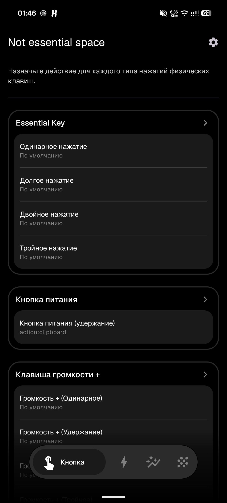
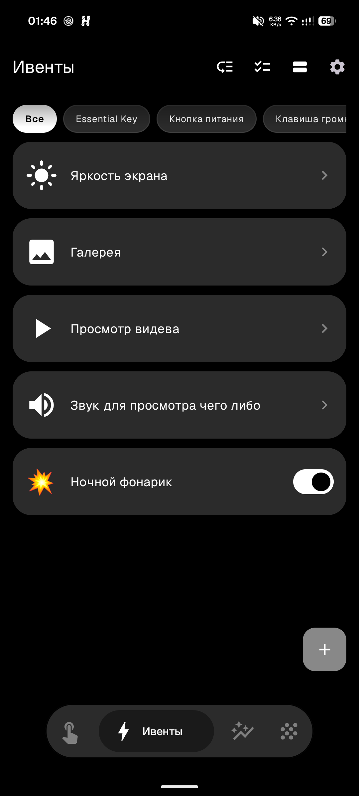
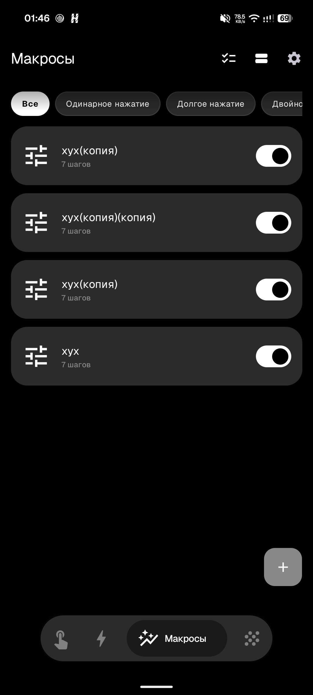

# Essent.aI ⚡️

Мощный Android-инструмент для Nothing Phone (3a) Lite, предназначенный для переназначения аппаратной кнопки **Essential Key** (`scanCode 250`) и полного контроля над устройством (макросы, глифы, ивенты и кастомные панели управления).

---

## 📸 Галерея интерфейсов

### 1. Главный экран настройки клавиш
<p align="center">
  
</p>
Назначение действий для Essential Key, кнопки питания и клавиш громкости по одинарному, двойному, тройному нажатию или удержанию.

---

### 2. Система Events (Ивенты)
<p align="center">
  
</p>
Выполнение автоматических действий и макросов при соблюдении заданных условий (время суток, открытое приложение, заряд батареи, положение устройства в пространстве и освещенность).

---

### 3. Система Macros (Макросы)
<p align="center">
  
</p>
Запись, редактирование и воспроизведение сложных последовательностей касаний, свайпов и задержек.

---

## 🚀 Основные возможности

* 🎛 **Переназначение Essential Key**: Настройка действий по одинарному, двойному, тройному нажатию и удержанию.
* 🤖 **Система Events (Ивенты)**: Интеллектуальное срабатывание макросов по условиям.
* 🎬 **Система Macros (Макросы)**: Запись макросов касаний и свайпов.
* ✨ **Интеграция с Glyph Interface**: Управление подсветкой Nothing через Glyph Matrix SDK.
* 🎛 **Кастомные панели**: 
  * **Favorites**: Быстрый барабан избранных приложений.
  * **Control Panel**: Настраиваемая сетка элементов управления.

---

## 🛠 Технический стек

* **Язык**: Kotlin (Coroutines, Flows)
* **UI**: Jetpack Compose (Material 3, Nothing OS styling)
* **Хранение данных**: Jetpack DataStore (Preferences)
* **Специфичные API**: 
  * `AccessibilityService` (перехват клавиши по `scanCode 250`)
  * `Nothing Ketchum SDK` (`glyph-matrix-sdk-2.0.aar`)
  * `SensorManager` (акселерометр, датчик света)
  * `Camera2` (управление фонариком)

---

## 📥 Установка (Сайдлоадинг)

1. Скачайте свежий APK (`EssentAI-0.5.1.apk`) из раздела [Releases](https://github.com/HojuNKg/Essent_aIl/releases).
2. Установите приложение на ваше устройство.
3. Откройте приложение и включите службу в настройках **Accessibility (Спец. возможности)**.

### 🔓 Освобождение одинарного нажатия
По умолчанию одинарное нажатие занято системными функциями Nothing. Чтобы освободить его (опционально), выполните через ADB:
```bash
adb shell pm disable-user --user 0 com.nothing.ntessentialspace
adb shell pm disable-user --user 0 com.nothing.ntessentialrecorder
adb shell pm disable-user --user 0 com.nothing.essentialintelligence
```

---

## 📦 Сборка из исходников

```bash
./gradlew :app:assembleDebug
```
Собранный APK будет находиться по пути: `app/build/outputs/apk/debug/EssentAI-0.5.1.apk`.

---

## 📄 Лицензия

[MIT](LICENSE) © 2026 HojuNK. Не связано с компанией Nothing.
